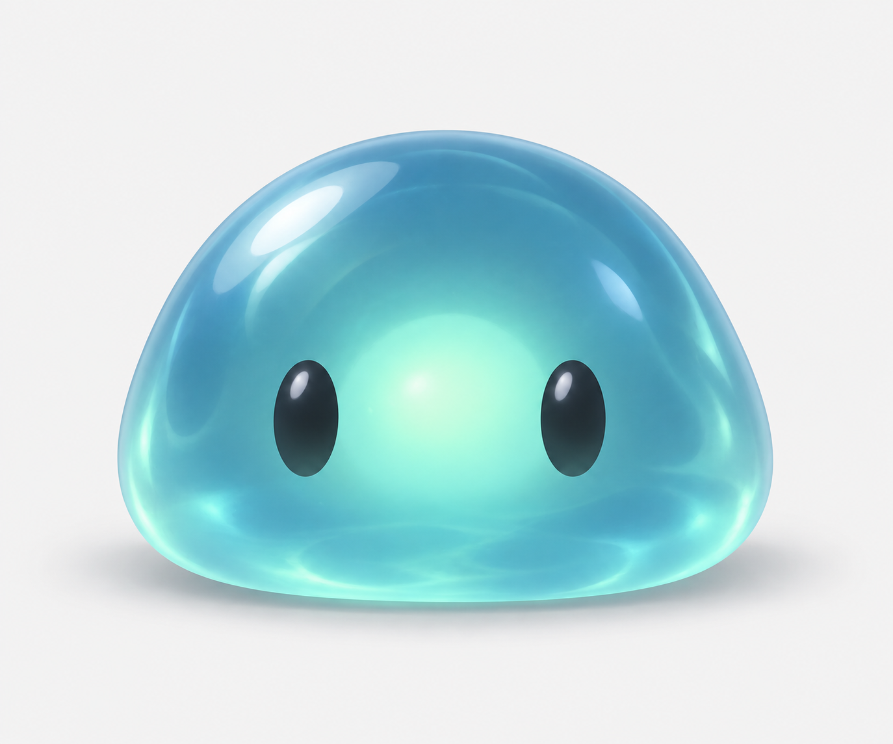
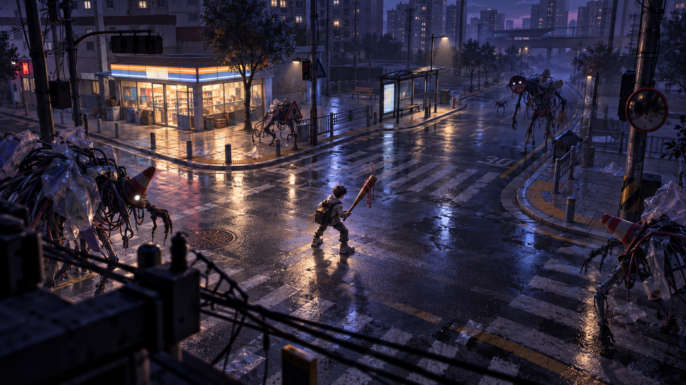
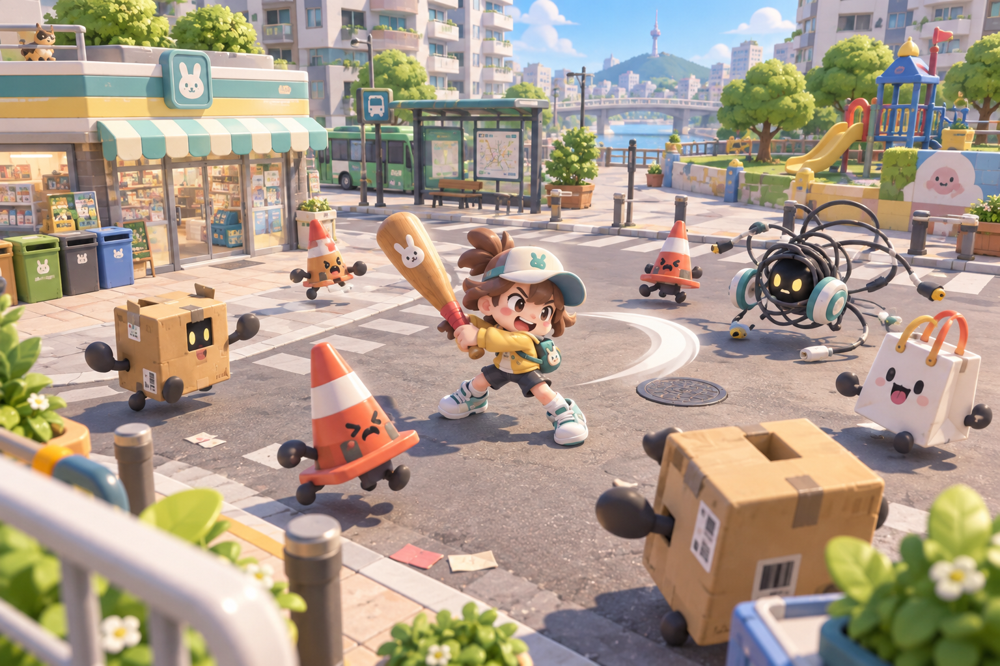
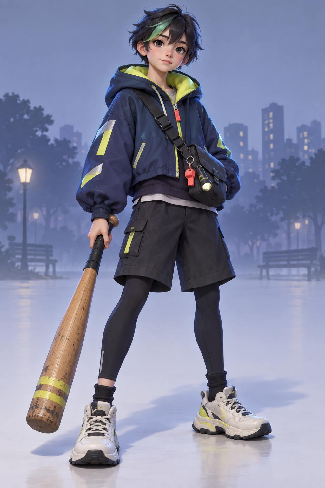
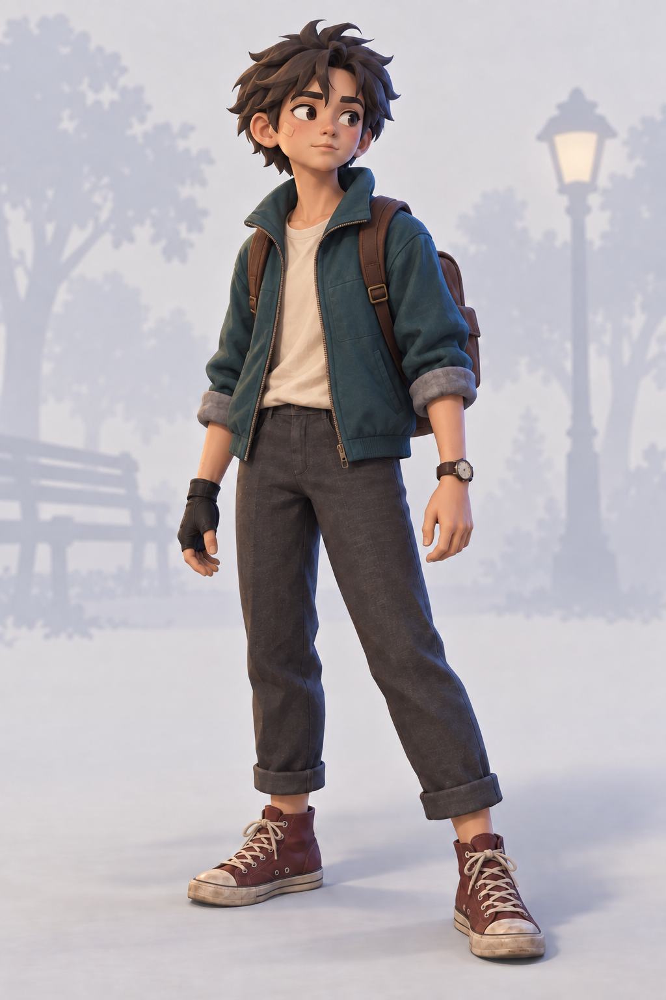
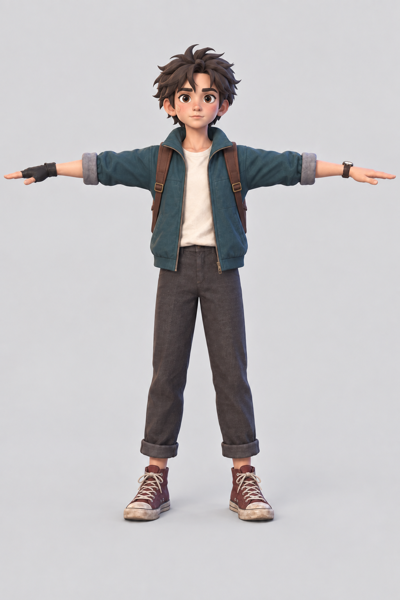
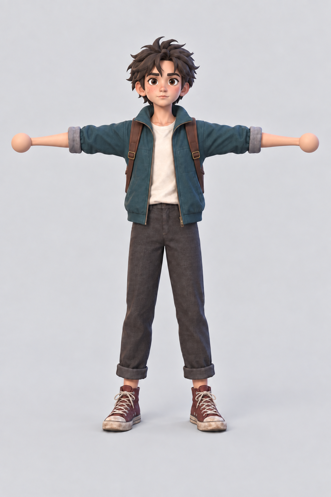
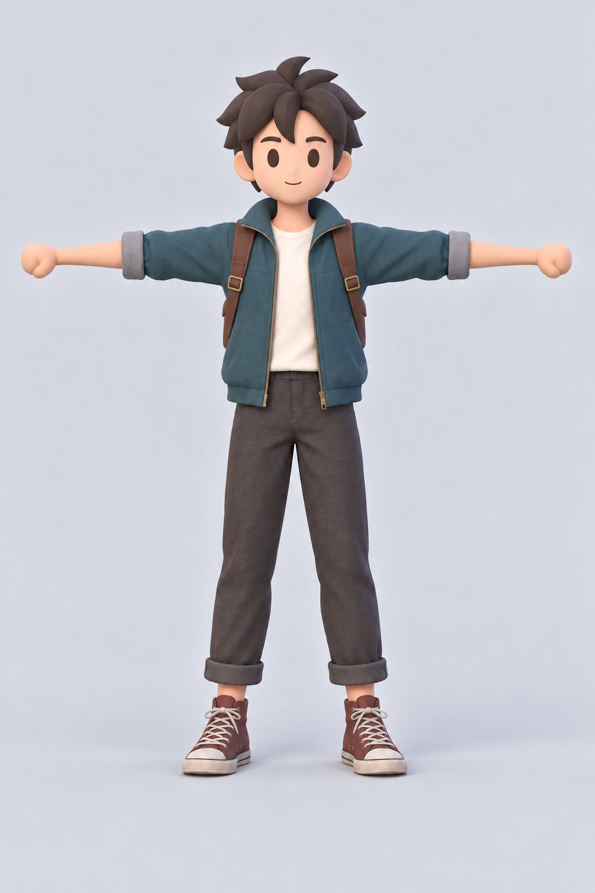
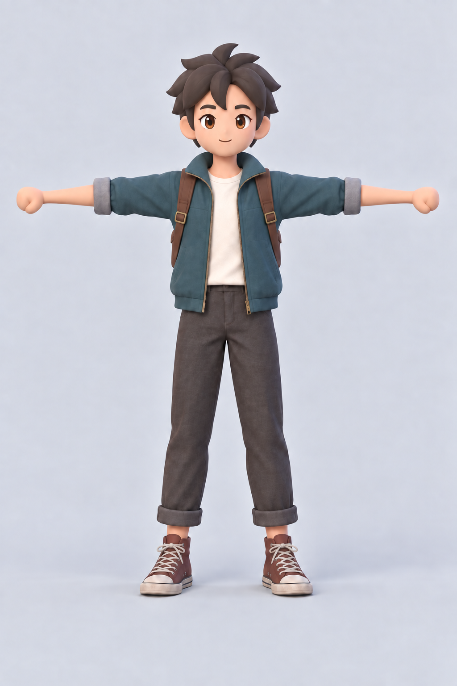
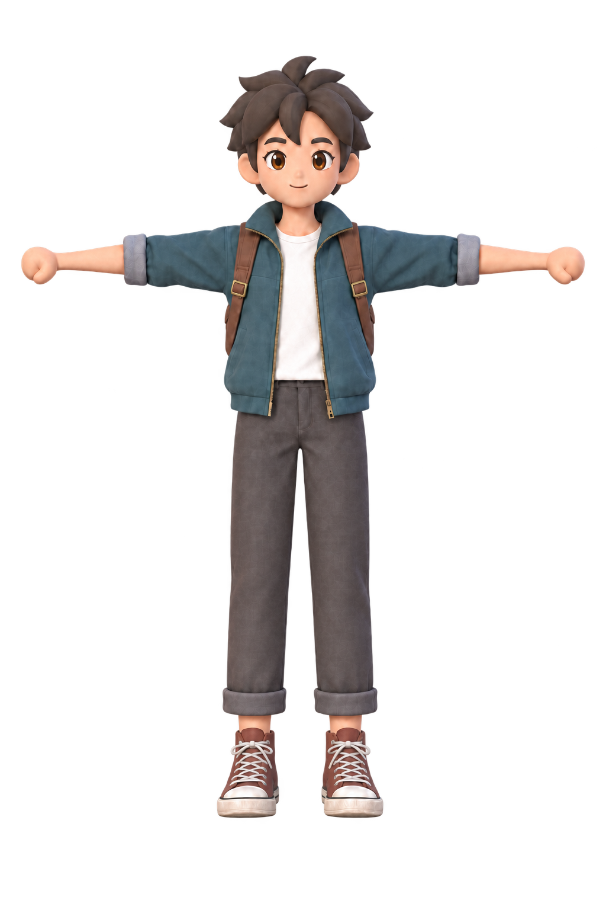

# 세계관·아트 콘셉트 논의 회의록

> 공개 편집본 p3 · 2026-10-27 · 문서 원본 `37ba4c4`. 공개 범위와 코드 기준은 [문서 색인](../README.md)을 따른다.

- 회의일: 2026-09-25

> 2026-09-25 회의의 스냅샷입니다. 이후 결정이 변경되었을 수 있습니다.

| 항목 | 요약 |
|---|---|
| 주제 | 무기·몬스터·도시 배경을 연결할 세계관과 아트 방향 |
| 선택 | 도시 공원에서 출발, 현대적 무기 포함, 슬라임으로 모델·움직임 시험 |
| 기각·유보 | 열망이 무기가 되는 설정 기각. 영혼 설정·낮밤의 두 트랙 구조 미채택 |
| 주요 이유 | 첫인상·공유할 콘셉트 중시. 영혼 설정과 잦은 무기 교체의 충돌 우려. 슬라임은 무난한 시험 대상 |
| 미정 | 사건·적 집단·최종 아트 기준·리소스 예산 |

---

## 1. 논의 목적

- **사용자 목표**
	- 무기·몬스터·도시 배경이 하나의 인상적인 세계로 읽히도록 세계관·콘셉트·아트 리소스 방향을 함께 정한다.
	- 조작과 전투의 재미뿐 아니라 첫인상과 공유할 만한 콘셉트도 플레이 유입에 기여해야 한다고 본다.
- **제작 방향**
	- 기존 아트 리소스는 필요하면 전면 교체할 수 있다. Codex 개발과 병행해 Meshy AI로 리소스를 시험 제작하는 방향이다.
	- 세계관·아트 방향을 콘텐츠 확장보다 앞당기자는 의견이 있으나 DevPlan의 단계 순서는 변경하지 않는다.

---

## 2. 세계와 배경

- **방향**
	- 도시를 배경으로 삼고 올림픽공원 같은 규모의 도시 공원을 첫 아레나의 출발점으로 잡는다.
	- 친숙하고 밝은 공원과 비일상적인 전투의 대비를 논의한다. 도시의 다른 구역은 이후 맵으로 확장할 수 있다.
- **검토한 설정**

	| 설정 | 판단 | 이유 |
	|---|---|---|
	| 밤에는 몬스터와 전투, 낮에는 도시 정리 | 검토 후 미채택 | 게임 루프 변경으로 이어짐 |
	| 누군가의 간절한 열망이 무기가 됨 | 사용자 명시적 기각 | 별도 사유는 기록에 없음 |
	| 무기에 사람의 영혼이 깃듦 | 흥미로운 발상으로 보류, 깊은 설정으로도 미채택 | 무기를 자주 교체하고 버리는 게임 동작과 충돌할 가능성 |

---

## 3. 무기와 적

- **무기 방향**
	- 판타지 무기에 한정하지 않고 야구 방망이·권총·'브루클린 배트' 같은 현대적 무기도 등장시킨다.
	- 서로 다른 시대·용도의 무기가 같은 공원에 나타나는 이유를 시각적 규칙이나 세계관의 사건으로 설명하는 것이 논점이다.
- **슬라임 시험**
	- 사용자는 첫 적 모델과 움직임을 시험할 무난한 대상으로 슬라임을 선택한다.
	- 정면을 보는 청록색 계열의 단순한 젤리형 적 이미지를 시험한다. 적 세력 전체의 미술 기준으로 확정한 디자인은 아니다.
	- 복잡한 리그 대신 메시의 늘어남·눌림과 위아래 움직임, 필요하면 셰이더 보조 효과로 유휴·이동·피격을 표현하는 방향을 제안한다. 구현 결정은 아니다.

	

	- 모델·움직임을 시험할 슬라임의 생성 시안이다. 게임 구현 화면이나 적 집단 전체의 확정 디자인은 아니다.

---

## 4. 아트 방향과 리소스 예산

- **취향과 탐색 방향**
	- 사용자는 밝고 캐주얼하며 친근한 캐릭터에 약간의 개성·미스터리를 원한다. 과하게 잘생기거나 영화 포스터처럼 정교한 표현은 원하지 않는다.
	- 형태가 읽히는 스타일라이즈드 3D를 탐색하며 Unity URP·쿼터뷰·다수의 적 동시 표시를 고려한다.

	| 어두운 도시 야경 | 밝고 캐주얼한 거리 |
	|---|---|
	|  |  |

	- 대화에서 생성한 톤 탐색 시안이다. 화면의 밝기·형태 차이를 비교하며, 등장하는 배경·적·소품의 채택을 뜻하지 않는다.
- **리소스 예산**

	| 항목 | 의견·제안 | 채택 상태 |
	|---|---|---|
	| 플레이어 예산 | 약 10~20K 삼각형 | 제작 검증 전 시험 제안 |
	| 일반 적 예산 | 약 1.5~4K 삼각형 | 제작 검증 전 시험 제안 |

	- 위 수치는 제작 검증 전의 시험 제안이며 확정 제작 규격이 아니다.

---

## 5. 플레이어 시안

- **캐릭터 인상**
	- 평범하게 공원을 걷던 사람처럼 보이지만 아무 무기나 능숙하게 다루는 '웨폰마스터'를 상상한다. 예상치 못한 전투에 놀라면서도 몸은 익숙하게 대응하는 인상이다.
	- 과거 비밀 요원 같은 경력은 분위기를 설명하는 예시이며 서사로 확정하지 않는다.
- **복장 탐색 시안**

	| 초기 전신 시안 | 백팩·무기 없는 시안 |
	|---|---|
	|  |  |

	- 생성 시안의 복장·휴대품 차이를 비교한다. 확정 모델이나 실제 플레이 화면은 아니다.

- **이미지 조정**

	| 대상 | 방향·변화 | 판단·이유 |
	|---|---|---|
	| 복장 | 짙은 청록색 캐주얼 재킷·밝은 상의·어두운 바지·붉은 갈색 운동화·작은 갈색 백팩. 크로스백과 손에 든 무기 제외 | 이미지 방향 |
	| 손 | 손가락이 분리되지 않은 단순한 쥔 주먹 선호. 완전한 구형 손은 사용자 피드백으로 제외 | 손가락 애니메이션 부담 축소 |
	| 얼굴 | 매끈한 얼굴형 시험 후, 사용자가 제시한 이전 스타일의 갈색 홍채·생기 있는 눈을 재적용 | Meshy 리메시 뒤 울퉁불퉁한 표면·짙은 그림자를 줄이려는 시도 |
	| 포즈 | 정면 T-pose·좌우 대칭·수평 팔·분리된 곧은 다리·평행하게 정면을 향하는 발을 목표로 반복 수정 | 목표 포즈 |

- **손 형태 비교**

	| 손가락이 분리된 펼친 손 | 구형 손 |
	|---|---|
	|  |  |

	- 손가락 애니메이션 부담을 줄이기 위한 형태 비교다. 구형 손은 제외하고, 아래 전체 시안처럼 단순한 쥔 주먹을 선호한다.

- **얼굴 표현 비교**

	| 얼굴을 단순화한 시안 | 갈색 홍채·눈 표현을 복원한 시안 |
	|---|---|
	|  |  |

	- 얼굴·눈 표현을 비교하는 생성 시안이다. 이 비교만으로 Meshy 리메시 결과나 표면 문제가 해결됐다고 판단하지 않는다.

- **시안과 확인 범위**
	- 아래는 대화에서 생성한 플레이어 시안이다. Meshy 모델 생성·리깅 결과는 검증되지 않았다.

	

	- 배경 제거 이미지의 검은 미리보기는 투명 영역 표시 방식일 가능성이 있다. 이미지 생성 방식의 배경 제거는 원본 픽셀 보존을 보장하지 않으므로 가장자리·알파 확인이 필요하다.

---

## 6. 미정 사항

| 주제 | 남은 논점 |
|---|---|
| 세계·사건 | 도시 이름·공원의 구체적 외형·시간대·사건 원인·세계관 핵심 문장. 무기 교체 게임플레이와 양립하는 설명 |
| 무기·적의 연결 | 무기군과 적 무리를 묶는 시각적 규칙, 슬라임 외의 적 집단과 공통점, 몬스터가 공원에 나타나는 이유 |
| 공통 아트 | 플레이어·적·공원에 적용할 조명·색 팔레트·재질·UI·환경 소품 기준. Meshy 시안과 Unity 조명 결과의 비교 |
| 리소스 예산 | 목표 실행 환경과 검증할 리소스 예산 |
